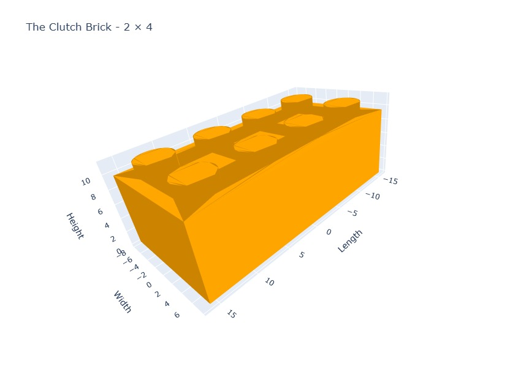

# ims-ai-2302110056
My IMS AI - Code Drops

**Name:** Tarun Mahananda

**Roll No:** 2302110056

## About The Repository 

This repository contains the Python and CadQuery projects I have completed as part of the IMS AI Code Drops tasks.

Day 7 – CAD Plate

File: "plate.py"

Created a rectangular plate with a cylindrical hole using CadQuery.

Concepts:

- Basic 3D shapes
- Boolean subtraction
- Volume calculation
- STL export

Day 8 – 2 × 4 Brick

File: "brick.py"

Created a toy brick with 8 studs arranged in 2 rows and 4 columns using Python loops.

Concepts:

- Python functions
- For loops
- Parametric modelling
- Boolean union
- Volume calculation

Day 10 – Battery Cell Tray

File: `battery_tray.py`

Created a battery tray with three cylindrical pockets for 18650 battery cells using CadQuery.

**Concepts:**
- Python dataclasses
- Dictionaries
- Functions
- For loops
- Parametric modelling
- Boolean subtraction
- Volume calculation
- STL export

Tools Used

- Python
- CadQuery
- Google Colab
- GitHub
  
Progress

- [x] Day 7 – First parametric CAD plate

- [x] Day 8 – 2 × 4 clutch brick

- [x] Day 10 - Battery Tray

